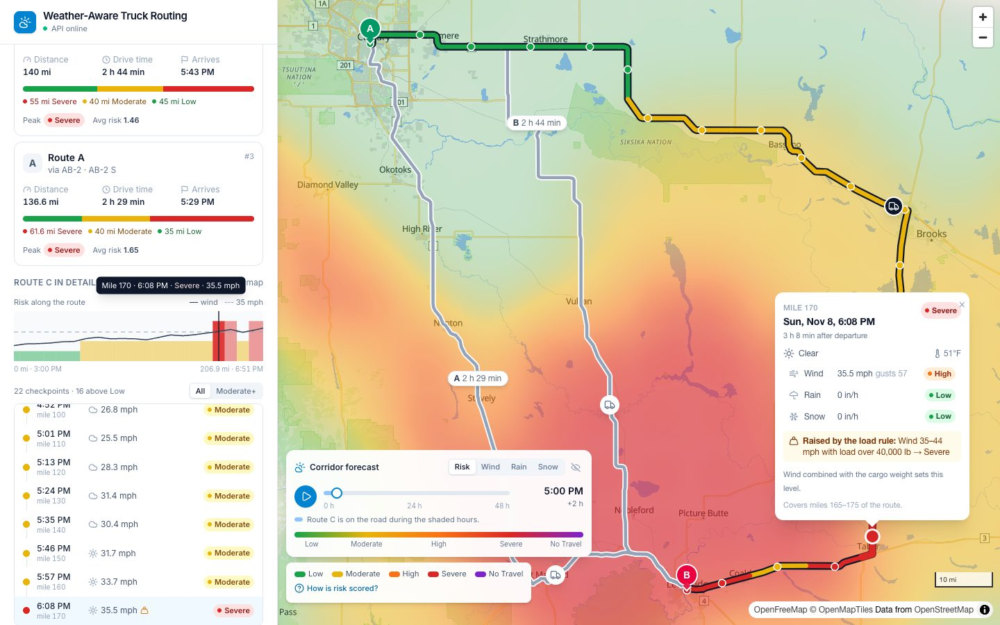
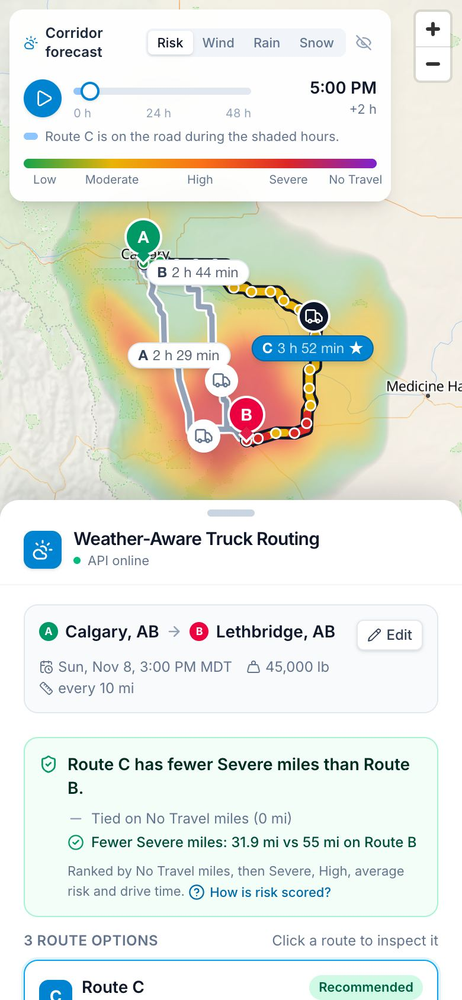
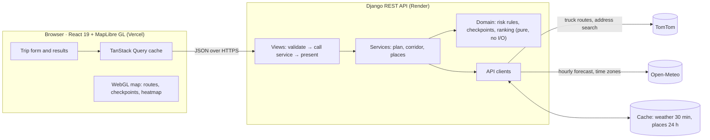
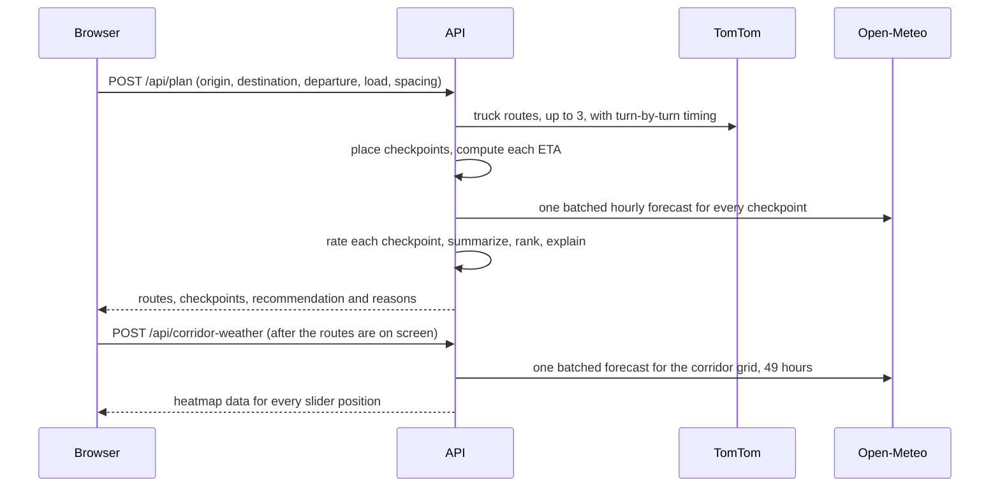

# Weather-Aware Truck Routing

A React + Django web app that helps a truck driver pick the **safest route** between two places,
based on the forecast weather along each route, the truck's load and travel time.



<sub>Calgary → Lethbridge with 45,000 lb of cargo during a forecast windstorm. Route C is
recommended although it is 1 h 20 min slower, because it spends the fewest miles in Severe
wind. The popup shows a checkpoint raised from High to Severe by the load rule.</sub>

## What it does

- **Plan a trip:** origin and destination (address autocomplete, a click on the map, or your
  location), departure date and time in the start city's time zone, cargo weight, and how often
  to check the weather (every 10, 25 or 50 miles).
- **Three truck routes** from TomTom's truck routing (vehicle weight is considered).
- **Weather at every checkpoint, at the hour the truck gets there:** wind, gusts, rain and snow
  from Open-Meteo, read at each checkpoint's ETA.
- **A risk level at each checkpoint** (Low → No Travel) from the brief's wind / rain / snow
  thresholds, raised by the load rules for heavy trucks in strong wind.
- **A recommended route** ranked by No Travel miles, then Severe miles, High miles, average risk
  and drive time, with a plain-language explanation of what decided it.
- **An interactive map:** all routes, the selected route coloured stretch by stretch, clickable
  checkpoints with the reasoning behind each level, a risk-by-mile chart and a checkpoint
  timeline, all linked to each other.
- **A corridor weather heatmap** with a **0–48 h forecast slider**, playback, a Risk / Wind /
  Rain / Snow toggle, and truck markers showing where each route would be at that hour.
- **Shareable trips:** every planned trip has a URL that re-plans it when opened.
- **Works on phones:** the panel becomes a bottom sheet over a full-screen map.

<p align="center">
  
</p>

## How the decision is made

Everything below is implemented in `backend/planner/domain/` (pure functions, no I/O) and
covered by unit tests. Every point the brief left open is decided, with reasons, in
**[ASSUMPTIONS.md](ASSUMPTIONS.md)**.

1. **Routes.** TomTom returns up to three truck routes (`travelMode=truck`, gross weight =
   cargo + a typical 35,000 lb empty rig). If a future departure time makes TomTom return
   fewer alternatives, the routes are requested again with current traffic.
2. **Checkpoints.** A checkpoint at mile 0, then every _N_ miles along the road, then the
   destination. Each checkpoint stands for the road halfway to its neighbours, so the stretches
   add up exactly to the route length.
3. **ETAs.** Interpolated from TomTom's turn-by-turn travel times, so slow city miles and fast
   interstate miles are both reflected (driving time only; no rest breaks).
4. **Weather.** The hourly forecast nearest each checkpoint's ETA: sustained wind (gusts are
   shown but not rated), rain + showers, and snowfall, in mph and inches per hour.
5. **Risk.** Each condition gets a level and the worst one counts:

   | Condition   | Low    | Moderate     | High         | Severe      | No Travel |
   | ----------- | ------ | ------------ | ------------ | ----------- | --------- |
   | Wind (mph)  | < 25   | 25 – <35     | 35 – <45     | 45 – <55    | ≥ 55      |
   | Rain (in/h) | < 0.10 | 0.10 – <0.25 | 0.25 – <0.50 | 0.50 – 1.00 | > 1.00    |
   | Snow (in/h) | < 0.5  | 0.5 – <1.0   | 1.0 – <2.0   | 2.0 – 3.0   | > 3.0     |

   **Load rules** can only raise a level: wind 45–54 mph with more than 30,000 lb → No Travel;
   wind 35–44 mph with more than 40,000 lb → Severe (wind ≥ 55 mph is No Travel for any load).

6. **Recommendation.** Routes are compared in this order and the first difference decides:
   fewest **No Travel** miles → fewest **Severe** miles → fewest **High** miles → lowest
   **average risk** (distance-weighted, 0–4) → shortest **drive time**. No Travel comes first
   because a No Travel mile is worse than a Severe one. If every route has No Travel miles, the
   least-bad one is still ranked first, but the app warns that no route is safe and offers
   later departures.

## Architecture



**Planning a trip** (`POST /api/plan`) makes one routing call and one batched weather call:



### Backend (`backend/planner/`)

| Layer    | Files                                                      | Responsibility                                                                         |
| -------- | ---------------------------------------------------------- | -------------------------------------------------------------------------------------- |
| Domain   | `domain/risk.py`, `sampling.py`, `ranking.py`, `geo.py`    | The graded logic. Pure functions on dataclasses; no Django, no network.                |
| Clients  | `clients/tomtom.py`, `clients/open_meteo.py`               | Typed wrappers that turn provider JSON into domain types and errors.                   |
| Services | `services/plan.py`, `corridor.py`, `places.py`             | Use cases that combine clients and domain logic, behind small interfaces (`ports.py`). |
| HTTP     | `views.py`, `serializers.py`, `presenters.py`, `errors.py` | Input validation, JSON shapes and one error format (`{detail, code, errors}`).         |

Weather lookups are snapped to a 0.05° grid, de-duplicated, cached for 30 minutes and fetched
in parallel batches of up to 100 locations. Routes are simplified (Douglas–Peucker, ~30 m)
before they are sent, so a 1,000-mile plan with three routes is about 50 KB gzipped.

### Frontend (`frontend/src/`)

| Folder              | Contents                                                                     |
| ------------------- | ---------------------------------------------------------------------------- |
| `api/`              | Typed client, response types matching the API, shared queries.               |
| `features/trip/`    | Form, address combobox, departure (time-zone aware), load slider, URL state. |
| `features/plan/`    | Recommendation, route cards, risk chart, checkpoint timeline and details.    |
| `features/map/`     | Map layers (routes, risk segments, checkpoints, heatmap), markers, camera.   |
| `features/heatmap/` | Corridor data, colour scales, slider panel, truck positions.                 |
| `store/`            | Small Zustand stores; components subscribe only to the slices they use.      |

**Map performance** (the brief weights it at 40% with the UI):

- Everything on the map is a WebGL layer fed by GeoJSON. The only DOM markers are A/B, the
  three route labels and the three trucks.
- Hovering changes paint expressions only; selecting a route swaps one small source (that
  route's risk segments and checkpoints).
- The heatmap receives all 49 hours in one response, stored as feature properties. Moving the
  slider swaps one paint expression: no request, no data upload, no re-render of the layers.
- The heatmap's blur and intensity are calibrated to its grid spacing so a uniform area shows
  its true value instead of the sum of overlapping points (the maths is in
  `features/heatmap/corridor.ts` and checked by a test).
- The map and MapLibre (~300 KB gzipped) load as a separate chunk, so the form appears first.

## Tech stack

| Layer               | Choice                                                                    |
| ------------------- | ------------------------------------------------------------------------- |
| Frontend            | React 19, TypeScript, Vite, Tailwind CSS v4, TanStack Query, Zustand      |
| Map                 | MapLibre GL via `react-map-gl` (WebGL), OpenFreeMap vector tiles (no key) |
| Backend             | Django 5.2, Django REST Framework, httpx                                  |
| Routing / geocoding | TomTom Routing (truck mode) and Search APIs                               |
| Weather, time zones | Open-Meteo hourly forecast (free, no key)                                 |
| Tests               | pytest (131 tests), Vitest (82 tests); both run in GitHub Actions CI      |
| Hosting             | Vercel (frontend), Render (API)                                           |

## Local development

**Prerequisites:** Python 3.12+, Node 22+, and a free [TomTom API key](https://developer.tomtom.com/)
with the **Routing** and **Search** APIs enabled (enable **Reverse Geocoding** too, so points
picked on the map get an address).

### Backend

```bash
cd backend
python3 -m venv .venv
source .venv/bin/activate
pip install -r requirements-dev.txt
cp .env.example .env          # then set TOMTOM_API_KEY
python manage.py runserver    # http://localhost:8000/api/health
```

### Frontend

```bash
cd frontend
npm install
cp .env.example .env          # VITE_API_BASE_URL=http://localhost:8000
npm run dev                   # http://localhost:5173
```

### Checks (the same as CI)

```bash
# backend
ruff check . && ruff format --check . && pytest
# frontend
npm run lint && npm run format:check && npm test && npm run build
```

## Environment variables

**Backend** (`backend/.env`)

| Variable                | Required | Description                                                     |
| ----------------------- | -------- | --------------------------------------------------------------- |
| `TOMTOM_API_KEY`        | yes      | TomTom key (Routing, Search, Reverse Geocoding)                 |
| `SECRET_KEY`            | prod     | Django secret key                                               |
| `DEBUG`                 | –        | `True` locally, `False` in production (default `False`)         |
| `ALLOWED_HOSTS`         | –        | Comma-separated; the Render hostname is added automatically     |
| `CORS_ALLOWED_ORIGINS`  | prod     | Comma-separated frontend origins, e.g. the Vercel URL           |
| `CACHE_URL`             | –        | Cache backend, e.g. Redis (default: in-memory per process)      |
| `PLAN_THROTTLE_RATE`    | –        | Rate limit for plan and corridor requests (default `20/min`)    |
| `GEOCODE_THROTTLE_RATE` | –        | Rate limit for search and time zone requests (default `90/min`) |
| `LOG_LEVEL`             | –        | Default `INFO`                                                  |

**Frontend** (`frontend/.env`)

| Variable             | Required | Description                               |
| -------------------- | -------- | ----------------------------------------- |
| `VITE_API_BASE_URL`  | yes      | Base URL of the API, no trailing slash    |
| `VITE_MAP_STYLE_URL` | –        | MapLibre style URL (default: OpenFreeMap) |

## API reference

All endpoints are under `/api`. Errors always have the shape
`{"detail": "...", "code": "...", "errors": {field: [messages]}}` (`errors` only for invalid
input). Codes: `invalid` (400), `no_route` (422), `upstream_error` (502), `not_configured` (503).

| Method | Path                         | Purpose                                                        |
| ------ | ---------------------------- | -------------------------------------------------------------- |
| GET    | `/health`                    | Liveness, and whether routing is configured                    |
| POST   | `/plan`                      | Routes, checkpoints, risk and the recommendation               |
| POST   | `/corridor-weather`          | Heatmap grid with 0–48 h of risk, wind, rain and snow          |
| GET    | `/geocode?q=`                | Address autocomplete (US, Canada, Mexico)                      |
| GET    | `/reverse-geocode?lat=&lon=` | Address of a point picked on the map                           |
| GET    | `/timezone?lat=&lon=`        | IANA time zone of a point, e.g. `America/Edmonton`             |
| GET    | `/risk-rules`                | The thresholds and load rules, so the UI never hard-codes them |

<details>
<summary><strong>POST /api/plan</strong>: request and response</summary>

```jsonc
// Request
{
  "origin": { "lat": 51.0447, "lon": -114.0719, "label": "Calgary, AB" },
  "destination": {
    "lat": 49.6956,
    "lon": -112.8451,
    "label": "Lethbridge, AB",
  },
  "departure_time": "2026-11-08T21:00:00Z", // up to 1 h ago … 7 days ahead
  "load_weight_lb": 45000, // 0 – 80,000
  "checkpoint_interval_miles": 10, // 10, 25 or 50
}
```

```jsonc
// Response (shortened)
{
  "recommendation": {
    "route_id": "C",
    "runner_up_id": "B",
    "decided_by": "severe_miles",
    "no_safe_route": false,
    "comparisons": [
      {
        "criterion": "no_travel_miles",
        "winner": 0,
        "runner_up": 0,
        "decisive": false,
      },
      {
        "criterion": "severe_miles",
        "winner": 31.9,
        "runner_up": 55,
        "decisive": true,
      },
    ],
  },
  "routes": [
    {
      "id": "C",
      "rank": 1,
      "via": ["TC-1 E", "AB-1 E"],
      "summary": {
        "distance_miles": 206.9,
        "duration_s": 13920,
        "miles_by_level": {
          "low": 55,
          "moderate": 120,
          "high": 0,
          "severe": 31.9,
          "no_travel": 0,
        },
        "average_risk": 1.04,
        "peak_level": 3,
      },
      "geometry": [[-114.07, 51.04], "…"], // GeoJSON order [lon, lat]
      "geometry_offsets_s": [0, "…"], // seconds after departure, per vertex
      "segments": [{ "checkpoint_index": 0, "level": 0, "coordinates": ["…"] }],
      "checkpoints": [
        {
          "index": 17,
          "mile": 170,
          "eta": "2026-11-09T00:08:00Z",
          "covers": [165, 175],
          "level": 3,
          "factors": { "wind": 2, "rain": 0, "snow": 0 },
          "drivers": ["load"],
          "load_rule": "Wind 35–44 mph with load over 40,000 lb → Severe",
          "weather": {
            "wind_mph": 35.5,
            "gust_mph": 57,
            "rain_in_hr": 0,
            "snow_in_hr": 0,
          },
        },
      ],
    },
  ],
}
```

Risk levels are numbers: 0 Low, 1 Moderate, 2 High, 3 Severe, 4 No Travel, `null` = no forecast.

</details>

<details>
<summary><strong>POST /api/corridor-weather</strong>: request and response</summary>

```jsonc
// Request: route lines (at most 3 paths, 1,500 points in total)
{ "paths": [[[-114.07, 51.04], [-112.85, 49.70]]], "departure_time": "2026-11-08T21:00:00Z", "load_weight_lb": 45000 }

// Response: one entry per grid cell, 49 values per series (hour 0 = departure hour)
{
  "start_time": "2026-11-08T21:00:00Z", "hours": 48, "spacing_miles": 8.1,
  "cells": [{ "lon": -113.4, "lat": 49.72, "risk": [1, 2, 3, "…"], "wind": [31.2, 38.4, "…"], "rain": ["…"], "snow": ["…"] }]
}
```

</details>

## Testing

- **Backend (pytest, 131 tests):** every threshold edge, each load rule, ranking ties and
  rounding, checkpoint placement and ETA interpolation, both API clients against recorded
  responses (`httpx.MockTransport`, no network), the plan and corridor services with fake
  providers, and every endpoint including errors. One test checks that the TomTom key never
  appears in logs.
- **Frontend (Vitest, 82 tests):** time-zone conversion (including DST), truck positioning,
  heatmap weights and colour scales, a numerical check of the heatmap calibration, threshold
  ranges, recommendation wording, URL encoding and form validation.

## Deployment

1. **API on Render:** New → Blueprint → choose this repo (it reads `render.yaml`). Set
   `TOMTOM_API_KEY` and `CORS_ALLOWED_ORIGINS` (your Vercel URL). Health check: `/api/health`.
2. **Frontend on Vercel:** import the repo and set **Root Directory** to `frontend`. Set
   `VITE_API_BASE_URL` to the Render URL, then redeploy.

> Render's free tier sleeps after 15 minutes idle, so the first request can take about 50 s.
> The app shows "The server may be waking up" while it does.

## Known limitations

- **Driving time only:** ETAs come from TomTom's travel time and do not include rest breaks or
  hours-of-service stops.
- **Forecast quality:** forecasts lose accuracy beyond about 3 days; departures are limited to 7
  days ahead so the whole trip stays inside the forecast.
- **Sustained wind is rated, gusts are not**, following the brief's single wind threshold table.
  Gusts are shown everywhere wind is shown.
- **Conditions outside the brief** (freezing rain, fog, visibility, road closures) are not rated.
- **One time zone per trip:** all times are shown in the start city's time zone, even when the
  route crosses into another one.
- **North America only** for address search; routing and weather would work elsewhere.
- **In-memory cache** by default: each server process has its own. Set `CACHE_URL` to Redis to
  share it.
